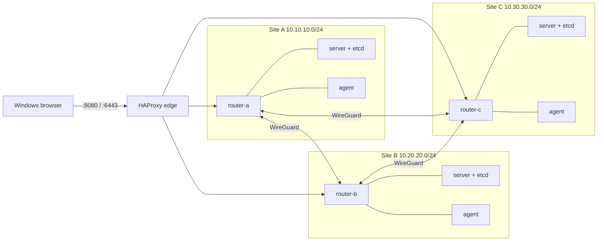

# Multi-Site, Fully Automated, Highly Available Platform

A resilient **three-site network** and a **Kubernetes platform** that is deployed, and rebuilt, entirely from code. The project includes a real demo application, automated failure tests and measured results.

> **Lab scope.** The three sites are simulated on a single Ubuntu VM: separate networks, routers, firewalls and encrypted tunnels, but one physical machine. The platform demonstrates the *mechanisms* of multi-site high availability (routing, quorum, health checks, failover, partitions), not protection against a real site or hardware failure. See [docs/HIGH_AVAILABILITY_DESIGN.md](docs/HIGH_AVAILABILITY_DESIGN.md).

**Assignment (Part 1):** *"Build a Multi-Site, Fully Automated, Highly Available Platform. Goal: Create a resilient multi-site network and a Kubernetes-based platform that is deployed and rebuilt entirely from code."* No further specifications or marking criteria were given; the design decisions and assumptions are recorded in [docs/ARCHITECTURE_DECISIONS.md](docs/ARCHITECTURE_DECISIONS.md).

---

## Project team and contributors

Group project, University of Lahore, Department of Technology. Instructor: Ms. Sana. Submitted 21 November 2026.

| Name | Registration number | Contribution |
|---|---|---|
| Saad Hussain Hashmi ([@saad-h-hashmi](https://github.com/saad-h-hashmi)) | 70154663 | **Step 1 (Part 1):** multi-site network, Kubernetes platform, automation, application, monitoring, testing and documentation (git tag `step-1`) |
| Sadia Alla Dita | 70154570 | **Step 2 (Part 2)**: upcoming |

## What is built



| Layer | Implementation |
|---|---|
| **Network** | 3 site LANs + 1 WAN (Docker bridges). One Alpine router per site with static routes, a default-deny iptables firewall and NAT. Full-mesh **WireGuard** tunnels between sites |
| **Shared services** | **HAProxy** edge (health-checked load balancing for the API and the apps), **CoreDNS** lab DNS (`lab.internal`), private **image registry** |
| **Kubernetes** | **K3s v1.37.2**: 3 servers with **embedded etcd** (one per site, quorum 2/3) + 3 agents; Flannel VXLAN inside the tunnels; Traefik ingress ×3; CoreDNS ×3 |
| **Application** | **SitePulse** (Python standard library): 3 replicas spread one per site, probes, metrics, live replica view, Redis counter on a PersistentVolume |
| **Monitoring** | **Prometheus** (kubelet, cAdvisor, etcd, kube-state-metrics, app, HAProxy) with alert rules; HAProxy statistics page |
| **Security** | RBAC least privilege, Pod Security *restricted*, NetworkPolicies, Secrets encrypted at rest, generated secrets never committed |
| **Automation** | **Ansible** roles + **Make** targets + **Kustomize**; idempotent; one-command deploy, rebuild, backup and restore |
| **Testing** | 27 network checks, 31 platform checks, 8 failure scenarios with availability probes, backup/restore and rebuild-from-code tests (results: [docs/TEST_REPORT.md](docs/TEST_REPORT.md)) |

## Quick start

```bash
git clone https://github.com/saad-h-hashmi/multi-site-ha-platform.git && cd multi-site-ha-platform
make bootstrap      # once: installs Docker, kubectl, WireGuard tools (asks for sudo password)
make deploy         # builds the whole platform (~6-9 min)
make health         # one-screen status
make test           # network + platform tests
```

Then open **http://192.168.30.128:8080** from Windows (or http://127.0.0.1:8080 on the VM).

## Prerequisites

Ubuntu 24.04+ (x86-64), 2 vCPU, 8 GB RAM, 5 GB free disk, internet access. Needs `git`, `make`, `ansible`, `python3`, `jq` and `curl`. **No nested virtualisation is needed.** Details: [docs/INSTALLATION_GUIDE.md](docs/INSTALLATION_GUIDE.md).

## Commands

| Command | Purpose |
|---|---|
| `make bootstrap` | One-time host setup (the only sudo step) |
| `make preflight` | Read-only check that the host is ready |
| `make deploy` | Deploy everything (idempotent) |
| `make network` / `services` / `kubernetes` / `app` / `monitoring` | Deploy one layer |
| `make health` | Health summary (exit code 0 = healthy) |
| `make net-status` | Routes, WireGuard peers, firewall counters per site |
| `make test` | Non-destructive tests (network + platform) |
| `make test-failover` | Failure tests: pod, liveness, readiness, worker, control plane, partition, site outage, quorum loss |
| `make test-rebuild` | Destroy → rebuild from code → test → restore data |
| `make backup` / `make restore-data` / `make restore-etcd` | Back up and restore state |
| `make rebuild` | Destroy and redeploy from code |
| `make clean` / `make clean-all` | Remove the lab (only `msha-*` objects) |

## Access

| Service | URL | Credentials |
|---|---|---|
| SitePulse | http://192.168.30.128:8080 | none |
| HAProxy stats | http://192.168.30.128:8404 | `admin` / `cat .secrets/haproxy-stats-password` |
| Prometheus | http://127.0.0.1:9090 (VM only) | none |
| Kubernetes API | `export KUBECONFIG=$PWD/build/kubeconfig` (Windows: `build/kubeconfig-windows`) | client certificate |

## Repository layout

```
ansible/            playbooks (00-50, site.yml), roles (host_setup, secrets, network, services, k3s, platform, monitoring)
  inventory/group_vars/all.yml   <- the single source of truth for the topology
infrastructure/     router image (Dockerfile)
app/sitepulse/      demo application + Dockerfile
kubernetes/         platform (namespaces, Traefik HA) and sitepulse manifests (Kustomize)
monitoring/         Prometheus + kube-state-metrics manifests
scripts/            preflight, health, net-status, backup, restore, destroy
tests/              test_network, test_platform, test_failover, test_rebuild
diagrams/           Mermaid sources (.mmd, rendered by GitHub) + network-topology.svg
docs/               design, guides, test report, viva preparation
evidence/           genuine test logs and failover measurements
submission/         final submission package
config/             lab.example.yml (copy to lab.yml for local overrides)
```

## Documentation

| | |
|---|---|
| Design | [Architecture](docs/ARCHITECTURE.md) · [Decisions](docs/ARCHITECTURE_DECISIONS.md) · [Network](docs/NETWORK_DESIGN.md) · [IP plan](docs/IP_ADDRESSING_PLAN.md) · [HA design](docs/HIGH_AVAILABILITY_DESIGN.md) · [Diagrams](docs/ARCHITECTURE_DIAGRAM.md) · [Security](docs/SECURITY.md) |
| Operate | [Installation](docs/INSTALLATION_GUIDE.md) · [Deployment](docs/DEPLOYMENT_GUIDE.md) · [Rebuild/Backup](docs/REBUILD_GUIDE.md) · [Testing](docs/TESTING_GUIDE.md) · [Troubleshooting](docs/TROUBLESHOOTING.md) |
| Results | [Test report](docs/TEST_REPORT.md) · [Final status](FINAL_STATUS.md) · [Progress log](PROJECT_PROGRESS.md) |
| Present | [Project report](docs/PROJECT_REPORT.md) · [Demo guide](docs/DEMO_GUIDE.md) · [Viva preparation](docs/VIVA_PREPARATION.md) |
| Audit | [Environment audit](docs/ENVIRONMENT_AUDIT.md) · [Resource plan](docs/RESOURCE_PLAN.md) |

## Troubleshooting

Run `make health` first; it names the failing layer. Every problem met while building this project, with its root cause and fix, is listed in [docs/TROUBLESHOOTING.md](docs/TROUBLESHOOTING.md).
