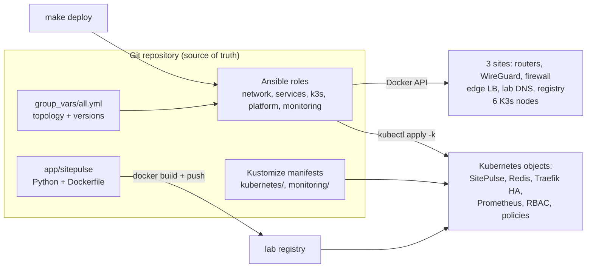
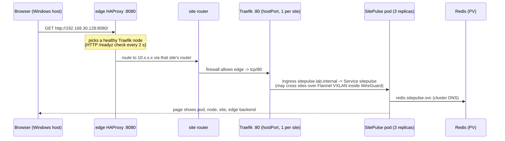

# Architecture

## 1. Summary

The platform is a **three-site, routed, Kubernetes-based environment that is built entirely from code**. A single command, `make deploy`, creates the sites, routers, encrypted links, firewalls, shared services, a six-node K3s cluster, the demo application and monitoring. A single command, `make rebuild`, destroys and recreates all of it.

Because the only hardware is one Ubuntu VM without nested virtualisation (see [ENVIRONMENT_AUDIT.md](ENVIRONMENT_AUDIT.md)), every site, router and Kubernetes node is a **container on one Docker Engine**. The network between them is real (separate namespaces, bridges, routes, WireGuard, iptables). The physical independence of the sites is **simulated**.

## 2. What runs at each site

| | Site A | Site B | Site C |
|---|---|---|---|
| LAN | 10.10.10.0/24 | 10.20.20.0/24 | 10.30.30.0/24 |
| Router | router-a: WireGuard, routing, firewall, NAT | router-b | router-c |
| Control plane | site-a-server: K3s server (API, scheduler, controllers) + **etcd member** | site-b-server + etcd member | site-c-server + etcd member |
| Worker | site-a-agent: kubelet + containerd | site-b-agent | site-c-agent |
| Workloads (normal state) | 1 SitePulse replica, 1 Traefik, 1 CoreDNS | 1 SitePulse replica, 1 Traefik, 1 CoreDNS | 1 SitePulse replica, 1 Traefik, 1 CoreDNS |

Shared services sit on the WAN segment, like services in a provider or cloud network: the **edge load balancer** (HAProxy), the **lab DNS** (CoreDNS) and the **image registry**. Single-instance stateful parts are placed by the scheduler: **Redis** (with its persistent volume) and **Prometheus**.

## 3. Layers

| Layer | Technology | Responsibility |
|---|---|---|
| Host | Ubuntu 26.04 VM, Docker Engine 29 | Runs every simulated machine as a container |
| Network | Linux bridges, Alpine routers, WireGuard, iptables | Three isolated sites, encrypted routed links, firewall policy |
| Shared services | HAProxy, CoreDNS, Docker Registry | Single entry point and health checks, naming, image distribution |
| Kubernetes | K3s v1.37.2, embedded etcd, Flannel VXLAN, Traefik, local-path storage, metrics-server | Container orchestration across sites |
| Application | SitePulse (Python), Redis | Demonstrates load balancing, health checks, recovery, persistence |
| Monitoring | Prometheus, kube-state-metrics, HAProxy stats | Metrics, alert rules, visual status |
| Automation | Ansible, Make, Kustomize, Bash tests | Deploy, rebuild, back up, restore, test |

## 4. How a request reaches the application

## 5. How the sites communicate

* **Underlay:** each router has one leg in its site LAN and one in the WAN.
* **Overlay:** the routers form a WireGuard full mesh. Each router routes the two remote site prefixes into `wg0`.
* **Kubernetes traffic:** etcd peers (2380), API (6443), kubelet (10250) and Flannel VXLAN (UDP 8472) cross sites inside the encrypted tunnels. Pod-to-pod traffic is therefore double-encapsulated: VXLAN inside WireGuard.
* **Policy:** routers drop all other inter-site traffic. See [NETWORK_DESIGN.md](NETWORK_DESIGN.md#4-firewall-policy-on-every-router).

## 6. How Kubernetes achieves availability

| Mechanism | Configuration | Effect |
|---|---|---|
| Replicated control plane | 3 K3s servers, one per site, embedded etcd (Raft) | Any **1** server or site can fail; quorum (2/3) remains |
| Load-balanced API | HAProxy with TCP health checks on all 3 API servers; agents keep their own client-side list of servers | `kubectl` and agents keep working when a server dies |
| Replicated workload | 3 SitePulse replicas spread across zones (`topologySpreadConstraints`, `maxSkew: 1`) | One replica per site; losing a site loses one replica |
| Fast failure handling | Node marked NotReady after 20 s; pods evicted after a 30 s toleration (defaults are 40 s and 300 s) | Replacement pods start on surviving sites within about a minute |
| Health checks | Startup, readiness (`/readyz`) and liveness (`/healthz`) probes | Broken pods leave the Service; hung pods are restarted |
| Redundant ingress and DNS | Traefik 3 replicas, one per site, listening on hostPort 80 (the edge health-checks each Traefik directly); CoreDNS 3 replicas | No single node holds the only ingress or DNS server; a dead ingress node is removed from the edge pool in about 4 s |
| Retries | HAProxy 500 ms connect timeout, 3 retries with `redispatch`; Traefik retry middleware with a 500 ms dial timeout | Requests that hit a just-failed node are retried elsewhere |
| Disruption budget | `PodDisruptionBudget minAvailable: 2` | Voluntary operations such as drains keep 2 replicas serving |

Detailed behaviour and the measured results are in [HIGH_AVAILABILITY_DESIGN.md](HIGH_AVAILABILITY_DESIGN.md) and [TEST_REPORT.md](TEST_REPORT.md).

## 7. Failure behaviour (summary)

| Failure | What happens |
|---|---|
| Pod crashes or is deleted | The Deployment creates a replacement; the Service only routes to ready pods |
| App hangs | Readiness fails, so it leaves the Service; liveness fails, so kubelet restarts it |
| Worker node fails | NotReady after ~20 s; its pods are rescheduled after a 30 s toleration; retries cover the gap |
| One control-plane node fails | etcd elects a new leader among the remaining 2; the API stays available through the edge |
| One site is partitioned | The isolated etcd member loses its leader (minority) and the other two sites keep quorum; when the link returns the member catches up automatically |
| A whole site is lost | Same as a partition, plus its pods are recreated in the surviving sites |
| Two sites lost | **No quorum**: the API stops answering (correct and safe behaviour). Pods that are still running keep serving where reachable. Recovers when a second site returns |
| The VM or laptop fails | **Everything stops.** This is the limit of a single-host lab |

## 8. How the platform is rebuilt from code

1. `make bootstrap`: one-time host packages (the only step that needs sudo).
2. `make deploy` runs `ansible/playbooks/site.yml`:
   `10-network` → `20-services` → `30-kubernetes` → `40-application` → `50-monitoring`.
3. Every step is **idempotent**: running it again changes nothing (verified, `changed=0`).
4. `make rebuild` = `scripts/destroy.sh` (removes only `msha-*` objects) + `make deploy`.
5. `make backup` / `make restore-data` / `make restore-etcd` protect state that cannot be regenerated from code.

See [REBUILD_GUIDE.md](REBUILD_GUIDE.md).
