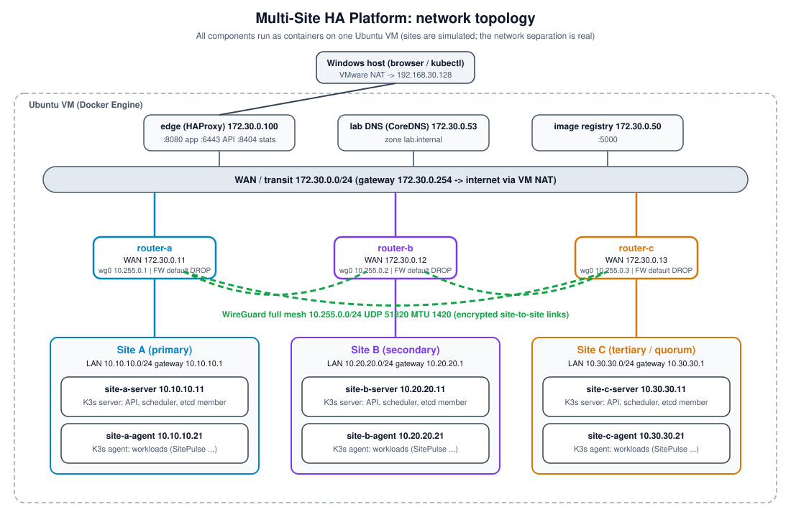
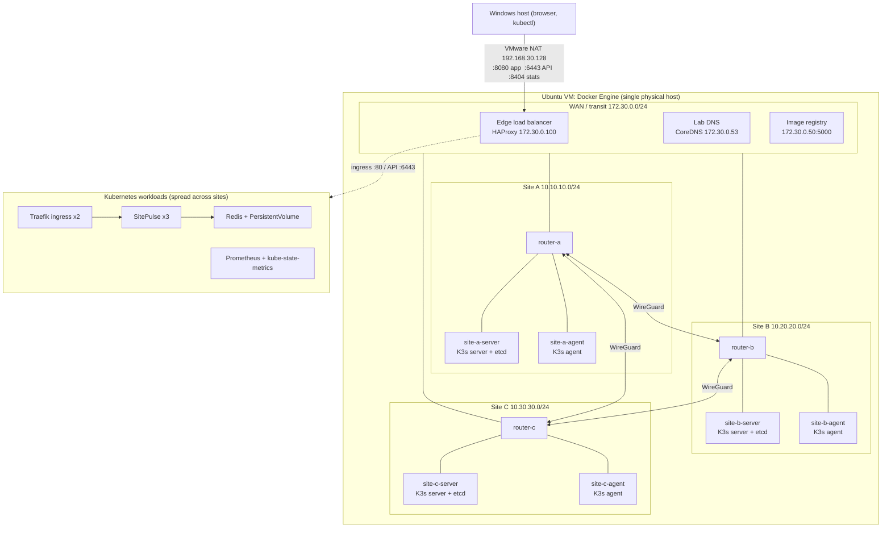
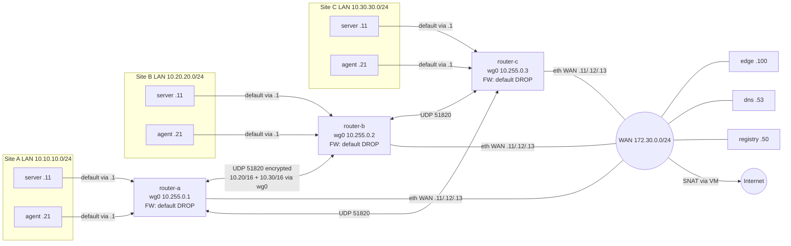
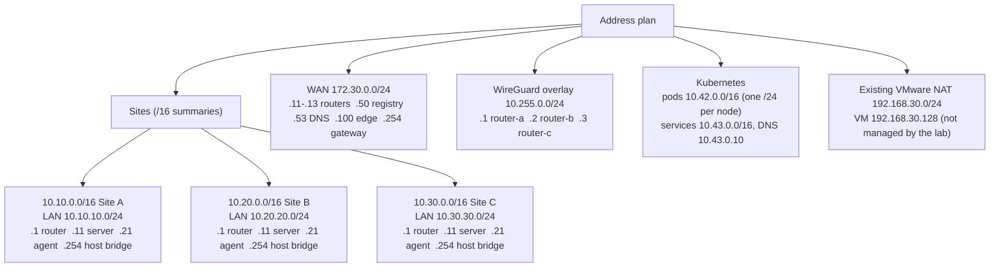
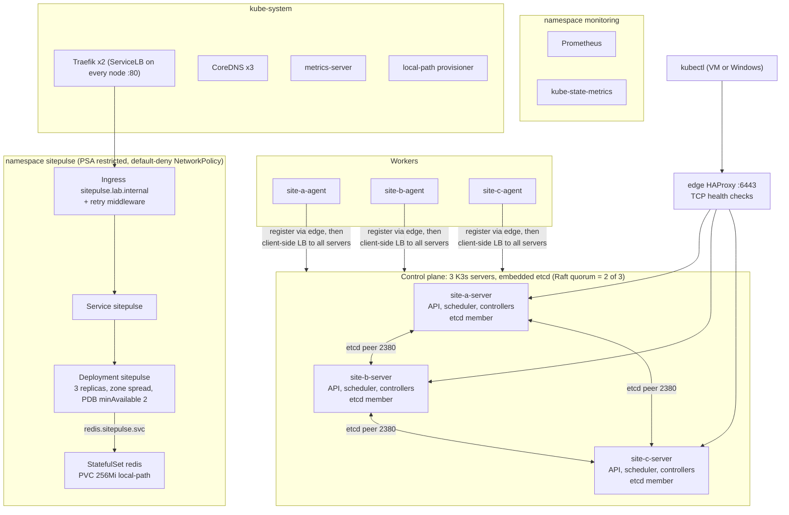
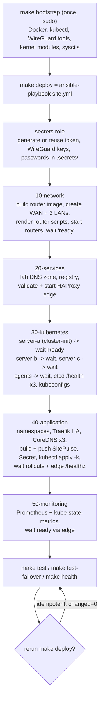
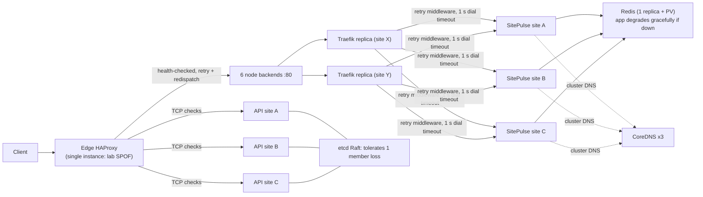

# Architecture Diagrams

Generated from the Mermaid sources in [`diagrams/`](../diagrams/) by `scripts/build-diagrams-doc.sh`.
GitHub renders these diagrams directly; paste a `.mmd` file into any Mermaid editor to export PNG/SVG.
A self-contained SVG of the network topology (no renderer needed) is [`diagrams/network-topology.svg`](../diagrams/network-topology.svg).



> Diagrams describe the **design**. They are not evidence that anything ran: the evidence is in [`evidence/`](../evidence/).

## Overall system architecture

Source: [`diagrams/01-system-architecture.mmd`](../diagrams/01-system-architecture.mmd)



## Three-site network topology with routing and firewall points

Source: [`diagrams/02-network-topology.mmd`](../diagrams/02-network-topology.mmd)



## IP addressing plan

Source: [`diagrams/03-ip-addressing.mmd`](../diagrams/03-ip-addressing.mmd)



## Kubernetes architecture: HA control plane and workload placement

Source: [`diagrams/04-kubernetes-architecture.mmd`](../diagrams/04-kubernetes-architecture.mmd)



## Deployment workflow (make deploy)

Source: [`diagrams/05-deployment-workflow.mmd`](../diagrams/05-deployment-workflow.mmd)



## High-availability design: redundancy at each layer

Source: [`diagrams/06-high-availability.mmd`](../diagrams/06-high-availability.mmd)



## Failure and recovery workflow (node or site failure)

Source: [`diagrams/07-failure-recovery.mmd`](../diagrams/07-failure-recovery.mmd)

```mermaid
sequenceDiagram
  participant N as Failed node / site
  participant E as Edge HAProxy
  participant C as Controller manager
  participant S as Scheduler
  participant P as New pod (other site)
  Note over N: t = 0 node stops (or its router is cut)
  E->>N: health check fails twice (2 s interval)
  E-->>E: t = 2-4 s backend DOWN, traffic to other nodes;<br/>in-flight failures retried (redispatch)
  C->>N: no kubelet heartbeat
  C-->>C: t = 20 s node NotReady, taint unreachable
  C-->>C: t = 20+30 s toleration expires, pods evicted
  S->>P: schedule replacement on a surviving site (zone spread)
  P-->>E: t ~ 50-60 s readiness passes, back to 3 replicas
  Note over N: node returns
  N->>C: kubelet heartbeat, node Ready
  N->>E: health check passes, backend UP
  Note over S: replicas are NOT moved back automatically;<br/>a rollout restart rebalances them
```
