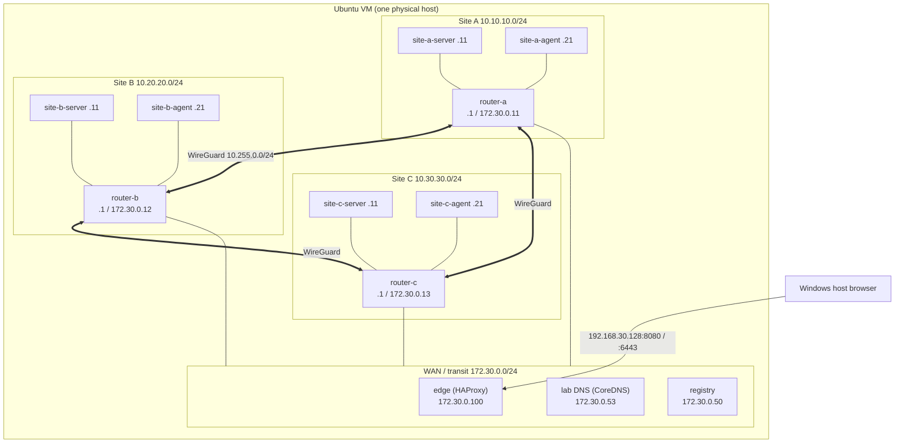

# Network Design

## 1. Goal

Build three **logically distinct sites** that behave like separate locations on a routed network: each has its own subnet, its own gateway, firewall rules at its edge, and an encrypted link to the other sites. The point is to be able to *break* the links between sites and observe what happens to the platform.

> **Honesty note.** All three sites run on one Ubuntu VM (one CPU, one disk, one power supply). The network separation is real: separate Linux network namespaces, bridges, routing tables, firewalls and tunnels. The *physical* independence is simulated. A single-host lab can demonstrate partitions and failover mechanisms, but not protection against a real site disaster.

## 2. Topology

## 3. How it is built

| Element | Implementation |
|---|---|
| Site LAN | A Docker **bridge network** per site (`msha-site-X-lan`): its own Linux bridge, broadcast domain and subnet. Docker blocks forwarding *between* bridges on the host, so sites cannot reach each other directly. |
| WAN | One more bridge (`msha-wan`) that only the routers and shared services join. |
| Router | Alpine Linux container with `iproute2`, `wireguard-tools` and `iptables`, attached to its site LAN and to the WAN. It forwards packets (`ip_forward=1`). |
| Site-to-site links | WireGuard full mesh between the three routers (3 tunnels), using kernel WireGuard with Curve25519 keys generated at deploy time. |
| Routing | Static routes on each router: the two remote `/16` prefixes go via `wg0`. Nodes have one default route, via their site router. The edge has a static route per site via that site's router. |
| Internet egress | Router → WAN gateway → VM NAT. Routers source-NAT site traffic leaving on the WAN. |

### Why traffic really goes through the routers

`tests/test_network.sh` proves it, rather than assuming:

* `traceroute` from Site A to Site B shows `10.10.10.1 → 10.255.0.2 → 10.20.20.99`: router-a, then the tunnel to router-b, then the destination (NET-04/05).
* WireGuard byte counters increase when sites talk (NET-06).
* Forcing a site to bypass its router, by using the host bridge as gateway, fails (ISO-01).

## 4. Firewall policy (on every router)

Default policy: **INPUT DROP, FORWARD DROP**. Only these flows are allowed:

| Direction | Allowed | Purpose |
|---|---|---|
| Site ↔ site (via `wg0`) | TCP 6443 | Kubernetes API / K3s supervisor |
| | TCP 2379–2381 | etcd client, peer, metrics |
| | TCP 10250 | kubelet (logs, exec, metrics) |
| | UDP 8472 | Flannel VXLAN (all pod-to-pod traffic) |
| | ICMP | Diagnostics |
| | *anything else* | **dropped** (`SITE_TO_SITE` chain, last rule) |
| Edge → site | TCP 80, 6443 from `172.30.0.100` only | Ingress and API load balancing |
| Site → WAN services | UDP/TCP 53 to DNS, TCP 5000 to the registry, TCP 6443/8405 to the edge | Name resolution, image pulls, agent registration, metrics |
| Site → internet | Allowed, but **all private ranges blocked** (`10/8`, `172.16/12`, `192.168/16`) | Image pulls from public registries; the lab cannot reach the home or VMware network |
| WAN → router | UDP 51820 from the two peer routers only | WireGuard |

TCP MSS is clamped on forwarded SYNs. Packet and byte counters for every rule are shown by `make net-status`.

## 5. Name resolution

* **Lab DNS** (`172.30.0.53`) is authoritative for `lab.internal` from a real zone file (SOA, NS and A records), and forwards other names to the VM's resolver. Every node uses it.
* **Cluster DNS** (CoreDNS inside K3s, `10.43.0.10`, 3 replicas) resolves Kubernetes service names and forwards everything else to the lab DNS.

## 6. Problems found and fixed while building the network

These were real issues, diagnosed with packet counters and rule inspection. They are kept here because they are useful to explain in the viva.

| Symptom | Root cause | Fix |
|---|---|---|
| Ping between sites failed although tunnels were up; router FORWARD counters stayed at 0 | Loading `br_netfilter` (needed by Kubernetes) set `bridge-nf-call-iptables=1` on the host. The host firewall then saw frames *inside* a bridge, and Docker 29's anti-spoofing rule (`raw PREROUTING -d <container> ! -i <its bridge> -j DROP`) dropped every routed packet. | Set `net.bridge.bridge-nf-call-iptables=0` **on the host only**. It is a per-network-namespace setting, so the K3s nodes keep their own value of 1. Docker's `nat-unprotected` mode was tried and **rejected**, because it also removes isolation between sites. |
| Nodes could not resolve DNS: queries reached the lab DNS, but answers never came back | Asymmetric routing. The DNS container replied through its default gateway (the host), which Docker correctly blocks. | Routers source-NAT site traffic towards the WAN, so replies return through the router. Inter-site traffic is **not** NATed, because etcd and Flannel need the real node IPs. |
| Pods failed to resolve full service names after 5 s | The lab DNS returned SERVFAIL (not NXDOMAIN) for unknown `*.lab.internal` names. Pods try `<name>.lab.internal` as a search domain, and musl's resolver treats SERVFAIL as fatal. | Serve a proper zone file with an SOA record, so unknown names get NXDOMAIN. |
