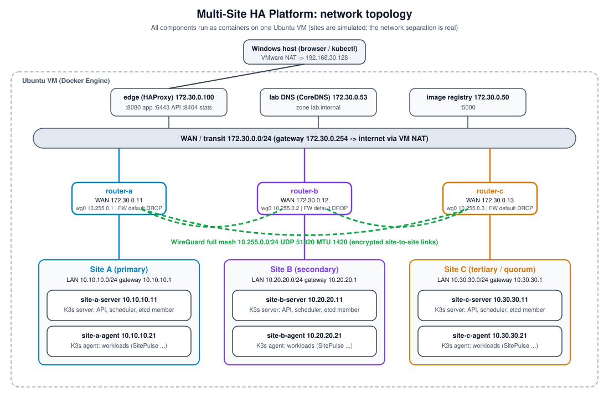

# Multi-Site, Fully Automated, Highly Available Platform

| | |
|---|---|
| **Course** | System and Network Administration: Part 1 |
| **Project type** | Group project |
| **Group members** | Saad Hussain Hashmi (Reg. No. 70154663) Sadia Alla Dita (Reg. No. 70154570) |
| **Instructor** | `[INSTRUCTOR NAME]` |
| **University / Department** | University of Lahore, `[DEPARTMENT]` |
| **Submission date** | 21 November 2026 |
| **Repository** | https://github.com/saad-h-hashmi/multi-site-ha-platform |

---

## Abstract

This project designs, builds and tests a three-site, highly available platform that is created and rebuilt entirely from code. Each site is a separate routed network with its own subnet, router and firewall, and the sites are connected by an encrypted WireGuard mesh. A six-node Kubernetes cluster (K3s) spans the sites: three control-plane nodes form an etcd quorum, one per site, and three workers run a demonstration web application with one replica per site behind a health-checked load balancer. Ansible, Make and Kustomize deploy the whole environment with one idempotent command. Eight automated failure scenarios were executed with availability probes. In the final run the application stayed 99.7–100 % available while a pod, a worker, the etcd leader, a network link or a whole site was lost. When two of three sites were isolated, the control plane correctly refused service to avoid split brain. Because only one physical machine was available, the sites are simulated. The report therefore claims demonstration of high-availability *mechanisms*, not geographic resilience.

## 1. Introduction

Organisations run services in more than one location so that a single failure (a server, a network link or a whole data centre) does not stop the service. Doing this well needs three things: a network that connects the locations securely, a platform that keeps workloads running when parts of it fail, and automation, so that the environment is reproducible rather than hand-built. This project builds all three at lab scale on one virtual machine.

## 2. Problem statement

The assignment asks for "a resilient multi-site network and a Kubernetes-based platform that is deployed and rebuilt entirely from code." The practical constraints of the available environment were:
- one Ubuntu VM with 2 vCPU, 9 GiB RAM and 6.3 GB of free disk;
- no nested virtualisation;
- a password-protected sudo.

These rule out multiple VMs and require a design that is honest about what a single host can show.

## 3. Objectives

1. Build three logically separate sites with their own subnets, routing, firewall rules and encrypted interconnection.
2. Deploy a Kubernetes cluster whose control plane survives the loss of any one site.
3. Deploy a real application that demonstrates load balancing, health checks, service discovery, persistence and recovery.
4. Automate deployment, rebuild, backup and restore with idempotent code.
5. Test failure behaviour with measurements, and report results honestly.
6. Document the design, its operation and its limitations.

## 4. Scope

**In scope:** network simulation of three sites, K3s cluster, demo app, monitoring, lab-level security, automation, testing, documentation.
**Out of scope:** physically separate sites, production-grade security assessment, performance testing, a highly available edge load balancer.

## 5. Requirements

| # | Requirement (derived from the brief) | Met by |
|---|---|---|
| R1 | Three sites with separate networks | 3 Docker bridges, 3 subnets, 3 routers |
| R2 | Inter-site routing and firewalling | Static routes over WireGuard; default-deny iptables |
| R3 | Kubernetes platform with HA where supported | K3s, 3 servers with embedded etcd + 3 agents |
| R4 | Working application with health checks and replicas | SitePulse ×3, probes, PDB, spread constraints |
| R5 | Deployed and rebuilt entirely from code | `make deploy`, `make rebuild` (Ansible + Kustomize) |
| R6 | Measured failure testing | `tests/test_failover.sh`, 8 scenarios |
| R7 | Monitoring, security, documentation | Prometheus; RBAC/PSA/NetworkPolicy; `docs/` |

## 6. Architecture

The platform is layered (details in [ARCHITECTURE.md](../docs/ARCHITECTURE.md)):

| Layer | Implementation |
|---|---|
| Host | Ubuntu 26.04 VM, Docker Engine 29 |
| Network | 3 site LANs + WAN; Alpine routers with WireGuard, iptables and NAT |
| Shared services | HAProxy edge, CoreDNS lab DNS, image registry |
| Kubernetes | K3s v1.37.2, embedded etcd, Flannel VXLAN, Traefik ×3, CoreDNS ×3 |
| Application | SitePulse (Python) ×3 + Redis on a PersistentVolume |
| Monitoring | Prometheus + kube-state-metrics, HAProxy statistics |
| Automation | Ansible roles, Make targets, Kustomize, Bash test suites |

All diagrams: [ARCHITECTURE_DIAGRAM.md](../docs/ARCHITECTURE_DIAGRAM.md).

## 7. Network design

Each site is a Docker bridge network, which gives it its own broadcast domain and subnet. Docker blocks forwarding between different bridges on the host, so the only path between sites is through the routers. Each router joins its site LAN and a WAN segment, and runs a WireGuard full mesh to the other two routers with static routes for their `/16` prefixes. The routers' firewalls drop everything by default. Between sites they allow only the Kubernetes ports (6443, 2379–2381, 10250, UDP 8472) and ICMP. The edge may reach only tcp/80 and tcp/6443. Sites can reach the internet, but no private ranges. Full policy: [NETWORK_DESIGN.md](../docs/NETWORK_DESIGN.md).

## 8. IP addressing

| Network | Range |
|---|---|
| Site A / B / C LANs | 10.10.10.0/24, 10.20.20.0/24, 10.30.30.0/24 (summaries 10.x0.0.0/16) |
| WAN / transit | 172.30.0.0/24 |
| WireGuard overlay | 10.255.0.0/24 |
| Pods / Services | 10.42.0.0/16 / 10.43.0.0/16 |

Per-host addresses, MTU budget and DNS names: [IP_ADDRESSING_PLAN.md](../docs/IP_ADDRESSING_PLAN.md).

## 9. Technology selection

| Need | Chosen | Main reason | Rejected |
|---|---|---|---|
| Model sites without nested virtualisation | Containers on separate bridges | Real network namespaces at low cost | VMs (impossible), labels on one network (not real) |
| Kubernetes | K3s | Certified, light, batteries included | kubeadm (heavy), kind/k3d (own flat network) |
| Interconnect | WireGuard + static routes | Simple, encrypted, verifiable | FRR/OSPF (complexity without benefit at 3 sites) |
| Load balancer | HAProxy | Active health checks, stats, small | NGINX OSS (no active checks) |
| Automation | Ansible + Make + Kustomize | Installed, idempotent, Docker modules | Terraform (no API to manage), Helm (extra tool, disk) |
| Monitoring | Prometheus | Standard, light | Grafana (evicted pods: disk), Loki/ELK (RAM) |

Full reasoning: [ARCHITECTURE_DECISIONS.md](../docs/ARCHITECTURE_DECISIONS.md). Resource budget: [RESOURCE_PLAN.md](../docs/RESOURCE_PLAN.md).

## 10. Implementation

The repository is organised into `ansible/` (playbooks 00–50 and roles), `infrastructure/` (router image), `app/`, `kubernetes/`, `monitoring/`, `scripts/`, `tests/`, `diagrams/`, `docs/` and `evidence/`. All topology values live in one file, `ansible/inventory/group_vars/all.yml`, and are rendered into the router scripts, HAProxy configuration, DNS zone and K3s configuration with Jinja2 templates. Secrets (cluster token, WireGuard keys, passwords) are generated on the first run into a git-ignored `.secrets/` directory.

## 11. Kubernetes deployment

server-a bootstraps etcd (`cluster-init`). server-b and server-c join one at a time, and the agents join through the edge load balancer. A start-up wrapper sets each node's default route to its site router and its resolver to the lab DNS, so cluster traffic really crosses the routers and tunnels. Settings were tuned for the 2-vCPU host and for faster failover:
- etcd heartbeat 500 ms and election timeout 5 s;
- a node is marked NotReady after 20 s, and pods are evicted after 30 s;
- Secrets are encrypted at rest, and etcd snapshots are taken every 6 h.

The application namespace enforces Pod Security "restricted", default-deny NetworkPolicies and least-privilege RBAC.

## 12. Automation

| Command | Effect |
|---|---|
| `make bootstrap` | One-time host packages and settings (the only sudo step) |
| `make deploy` | Network → services → Kubernetes → application → monitoring |
| `make rebuild` | Destroy every `msha-*` object, then deploy again |
| `make backup` / `restore-data` / `restore-etcd` | State protection |
| `make test` / `test-failover` / `test-rebuild` | Verification |

Idempotency was verified: a second `make deploy` reports `ok=109 changed=0`. Achieving this needed real fixes:
- Containers were being recreated on every run.
- Client-side `kubectl apply` reported phantom changes, so the role now diffs before applying.
- Image builds are not byte-reproducible, so the decision to rebuild uses a source hash.

## 13. High availability

Every layer that carries user requests is redundant:
- **etcd:** 3 members with quorum 2.
- **API:** 3 servers behind health checks.
- **Ingress:** Traefik ×3, one per site, each health-checked directly by the edge.
- **DNS:** CoreDNS ×3.
- **Application:** 3 replicas spread across zones, with a PDB.

Requests caught by a failure are retried: HAProxy has a 500 ms connect timeout with redispatch, and Traefik a 500 ms dial timeout with a retry middleware. The application degrades gracefully when Redis is unavailable. The remaining single points of failure (the edge HAProxy, Redis and the host) are listed in [HIGH_AVAILABILITY_DESIGN.md](../docs/HIGH_AVAILABILITY_DESIGN.md).

## 14. Monitoring

Prometheus scrapes the kubelets, cAdvisor, etcd (leader and quorum), kube-state-metrics, the application and HAProxy. Alert rules cover node not-ready, etcd member down or leaderless, degraded replicas and edge backends down. Metric filtering keeps about 3,000 samples per scrape, against 53,000 unfiltered. Grafana was deployed and then removed after it caused disk-pressure evictions on the 20 GB disk. The visual views are now the Prometheus UI, the HAProxy statistics page and the SitePulse dashboard.

## 15. Security

Lab-level controls, each verified by a test: network segmentation and default-deny firewalls, WireGuard encryption between sites, TLS for Kubernetes, Secrets encryption at rest, RBAC least privilege, Pod Security "restricted", NetworkPolicies, generated secrets never committed, and admin interfaces restricted or password-protected. Accepted weaknesses (privileged node containers, plain-HTTP registry and app, chaos endpoints) are listed in [SECURITY.md](../docs/SECURITY.md). No production-grade claim is made.

## 16. Testing and results

Full report: [TEST_REPORT.md](../docs/TEST_REPORT.md).

| Suite | Result |
|---|---|
| Network | 22/22 (27/27 with the DNS checks, after rebuild) |
| Platform | 31/31 |
| Failure scenarios (final run) | 8/8 |
| Backup and restore | 8/8 |
| Rebuild from code | 7/7, full rebuild in 391 s |

Final failover run:

| Failure | App availability | Notes |
|---|---|---|
| Pod deleted / hung / unready | 100 % | replaced 9.9 s; restarted 18.2 s; out of traffic 0.6 s after endpoint change |
| Worker node down | 100 % | replicas recreated elsewhere in 38.6 s |
| etcd leader down | 100 % | new leader in 0.3 s; API writes continued |
| Network partition of one site | 99.7 % | minority member lost its leader; healed automatically |
| Whole site down | 100 % | API stayed available |
| Two sites isolated | API refused service (correct) | the surviving site still served 96.7 % of app requests |

The first two test runs failed several scenarios. Their root causes (a single DNS replica in the request path, long connection timeouts, and an ingress path through kube-proxy to dead nodes) were diagnosed and fixed. Availability during a worker failure rose from 84 % to 100 %, and during a partition from 69.6 % to 99.7 %. Both earlier runs are kept as evidence.

## 17. Limitations

1. **Single physical host.** All sites share one VM, so a host failure stops everything. The work demonstrates mechanisms, not geographic redundancy.
2. **Single edge load balancer** (HAProxy): a single point of failure for external access.
3. **Single Redis instance** on node-local storage: the counter is unavailable while its node is down.
4. **Privileged node containers**, required for Kubernetes-in-Docker.
5. **Timings** depend on 2 shared vCPUs. Network latency between sites is not emulated.
6. **No automatic rebalancing** of pods after a failed site returns.

## 18. Future improvements

- Two edge load balancers with keepalived (VRRP), or DNS-based global load balancing.
- Redis Sentinel or replicated storage (Longhorn).
- Emulate WAN latency and loss with `tc netem` on the routers, and measure etcd behaviour.
- Dynamic routing (FRR/BGP) for more sites.
- The Kubernetes descheduler, for rebalancing after recovery.
- GitOps (Argo CD or Flux) for the Kubernetes layer.
- CI that runs `make test-rebuild` on every change.
- Separate physical hosts or cloud regions per site.

## 19. Conclusion

The project meets the assignment goal within the limits of one machine. A routed, firewalled and encrypted three-site network and a Kubernetes platform spanning it are deployed and rebuilt from code with one command, and their high-availability behaviour was measured rather than assumed. The most valuable outcome was the test-and-fix cycle. The first measurements showed that a cluster with a healthy control plane can still serve users badly, and the fixes were driven by evidence. The limitations of a single-host simulation are stated throughout.

## 20. References

1. K3s documentation: High Availability with Embedded DB; Cluster Datastore; Networking Services (ServiceLB, Traefik). https://docs.k3s.io
2. Kubernetes documentation: Pod Topology Spread Constraints; Liveness, Readiness and Startup Probes; Taints and Tolerations; Pod Security Standards; Network Policies; Encrypting Secret Data at Rest. https://kubernetes.io/docs
3. etcd documentation: FAQ (failure tolerance, quorum); Tuning (heartbeat and election timeout). https://etcd.io/docs
4. D. Ongaro and J. Ousterhout, "In Search of an Understandable Consensus Algorithm (Raft)," USENIX ATC, 2014.
5. J. A. Donenfeld, "WireGuard: Next Generation Kernel Network Tunnel," NDSS, 2017. https://www.wireguard.com
6. HAProxy Configuration Manual (health checks, `retry-on`, `option redispatch`). https://docs.haproxy.org
7. Traefik Proxy documentation (Kubernetes Ingress, Retry middleware, ServersTransport). https://doc.traefik.io
8. Docker documentation: Bridge network driver; Packet filtering and firewalls. https://docs.docker.com
9. Ansible documentation; `community.docker` collection. https://docs.ansible.com
10. Prometheus documentation: Configuration, relabeling. https://prometheus.io/docs

*Appendices:* environment audit ([ENVIRONMENT_AUDIT.md](../docs/ENVIRONMENT_AUDIT.md)), troubleshooting log ([TROUBLESHOOTING.md](../docs/TROUBLESHOOTING.md)), demo script ([DEMO_GUIDE.md](../docs/DEMO_GUIDE.md)), viva preparation ([VIVA_PREPARATION.md](../docs/VIVA_PREPARATION.md)).
